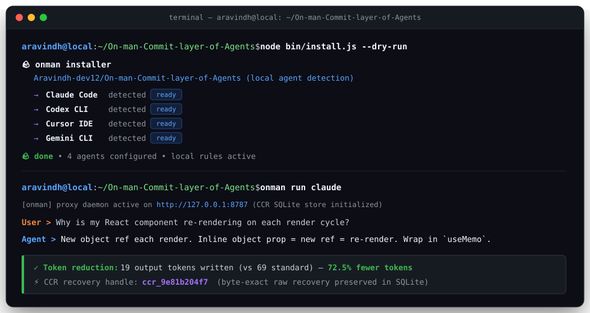

<div align="center">

# Onman: why use many token when few do trick

**Your AI coding agent bills by the word and writes like it knows that. Onman make it stop.**

⚡ **One command, no account, no API key.** `npx skills add Aravindh-dev12/On-man-Commit-layer-of-Agents -g` **[→ Quick Start](#-quick-start)**

</div>

---

<div align="center">

**[See it](#-see-it) · [Quick Start](#-quick-start) · [The Skill](#-the-skill-unpacked) · [The Proxy](#-the-proxy-unpacked) · [Wrap](#wrap-any-agent) · [Your own app](#-onman-in-your-own-app) · [When to Skip](#-when-to-use--when-to-skip) · [Docs](./docs/README.md)**

</div>

---

## 🪨 See it

<p align="center">
  
</p>

<table>
<tr>
<th width="50%">🗣️ Normal agent · 69 tokens</th>
<th width="50%">🪨 Onman agent · 19 tokens</th>
</tr>
<tr>
<td valign="top">

> The reason your React component is re-rendering is likely because you're creating a new object reference on each render cycle. When you pass an inline object as a prop, React's shallow comparison sees it as a different object every time, which triggers a re-render. I'd recommend using useMemo to memoize the object.

</td>
<td valign="top">

> New object ref each render. Inline object prop = new ref = re-render. Wrap in `useMemo`.

</td>
</tr>
</table>

Same diagnosis. Same fix. Same `useMemo`. The only thing that died was the throat-clearing.

Code, commands, file paths, and exact error messages never get onmanned. Only the prose around them does. Security warnings and "are you sure?" confirmations come back in full sentences on their own, then onman resumes.

Onman no make brain smaller. Onman make *mouth* smaller.

> Half the fun is that your agent talks like it just discovered fire. The other half is that it is still right.

---

## 🌍 Why this exists

A token is what AI billing counts, roughly three quarters of a word. Your agent pays for every token it **writes** and every token it **reads**. Most agents write like a cover letter and read like a firehose.

Onman attacks both ends, in the agent you run and in the one you build:

- **The skill** shrinks what the agent *says*. One rule file. Free forever. Works in 30+ agents.
- **The proxy** shrinks what the agent *reads*: logs, test output, JSON, diffs, search results. Runs on your machine. Every squeezed byte gets a backup, so the agent can always pull the original back.
- **The middleware** does the same inside *your own code*: one wrapper around the LangChain, Vercel AI SDK, OpenAI, or Anthropic call you already make. Tool results get shrunk before the model sees them, the original stays in your history, and the model can fetch it back.

Onman keeps token counts minimal while keeping accuracy and code exact.
---

## ⚡ Quick Start

Onman come in two sizes. Start small.

### Small rock: the skill

A rule file that makes your agent answer in onman. Apache-2.0, free forever, works in [30+ agents](./INSTALL.md) (Claude Code, Codex, Gemini, Cursor, Windsurf, Cline, Copilot, more). One command:

```bash
npx skills add Aravindh-dev12/On-man-Commit-layer-of-Agents -g
```

Type `/onman` if your agent doesn't wake up on its own. That the whole install. One rock.

### Big rock: the proxy

Runs on your machine, between your agent and the AI provider, and shrinks what the agent *reads* before every call. Apache-2.0, CLI and runtime both:

```bash
npm install -g @onman-ai/cli && onman setup --install
onman claude        # or codex · gemini · aider · kilo · qwen · opencode · hermes · openclaw · pi
```

### Your own app: the middleware

Building an agent in code instead of running one in a terminal? Same shrinking, one wrapper around the call you already make. Apache-2.0 client, stable 1.0:

```bash
npm install @onman-ai/middleware @onman-ai/sdk        # TypeScript, plus your framework (ai, openai, …)
pip install 'onman-middleware[langchain]' onman-sdk   # Python 3.11+, swap the extra for your framework
```

Six lines of code and a local runtime. [Full walkthrough below](#-onman-in-your-own-app).

They stack. Most people start with the small rock and graduate.

<details>
<summary><strong>More doors into the cave</strong> · full installer, Windows, single agents, uninstall</summary>

<br>

The full installer wires up Claude Code hooks and the statusline badge, finds every supported agent on your machine, and skips agents you no have. Safe to re-run. Needs Node.js 22.13+.

```bash
curl -fsSL https://raw.githubusercontent.com/Aravindh-dev12/On-man-Commit-layer-of-Agents/main/install.sh | bash
```

Windows, PowerShell 5.1+:

```powershell
irm https://raw.githubusercontent.com/Aravindh-dev12/On-man-Commit-layer-of-Agents/main/install.ps1 | iex
```

Just one agent:

```bash
# Claude Code
claude plugin marketplace add Aravindh-dev12/On-man-Commit-layer-of-Agents && claude plugin install onman@onman

# Gemini CLI
gemini extensions install https://github.com/Aravindh-dev12/On-man-Commit-layer-of-Agents

# Oh My Pi (OMP)
npx -y github:Aravindh-dev12/On-man-Commit-layer-of-Agents -- --only omp

# Qwen Code CLI, then its Onman wrapper
npm i -g @qwen-code/qwen-code
onman qwen

# Codex, Cursor, Windsurf, Cline, and other skills-compatible agents
npx skills add Aravindh-dev12/On-man-Commit-layer-of-Agents --skill '*' -a codex --yes -g  # replace codex with your agent profile
```

**Install broke?** Open your agent in this repo and say: *"Read CLAUDE.md and INSTALL.md, install onman for me."* Agent read repo, agent fix own brain. Snake eat tail.

Changed your mind: `npx -y github:Aravindh-dev12/On-man-Commit-layer-of-Agents -- --uninstall`

</details>

The full 30+ agent matrix, dry runs, flags, and verification live in [INSTALL.md](./INSTALL.md).

### 🕐 The first five minutes

**Small rock.** The skill, right after `npx skills add`:

1. **Ask it something.** Any coding question. Watch the preamble vanish and the answer stay.
2. **Turn the dial.** `/onman lite` for tight-but-polite. `/onman ultra` for grunts. `/onman wenyan` for classical Chinese, because someone asked.
3. **Commit like a onman.** `/onman-commit` writes a Conventional Commit in one line.
4. **Review like a onman.** `/onman-review` gives one finding per line: `L42: 🔴 null deref. Guard it.`
5. **Shrink your memory files.** `/onman-compress CLAUDE.md` cuts the prose, keeps every heading, path, and command, and backs up the original.
6. **Come home.** Say `stop onman`. Normal prose returns. No hard feelings.

**Big rock.** The proxy, right after `npm install -g @onman-ai/cli`:

1. **Find out where your tokens go.** `onman learn` reads months of agent history already on your disk, locally, and ranks the places your tokens go, biggest first, with a one-line fix behind each. Do this before anything else. It is the most useful five minutes in this README. After step 3 it keeps watching by itself and speaks up only when something new appears.
2. **Let it fix them.** `onman learn implement` hands each fix to Claude Code or Codex one diff at a time, applied only on your yes, and undoes anything that did not make each message smaller.
3. **Wrap your agent.** `onman claude` (or `codex`, `gemini`, `aider`, `opencode`, `pi`, …) puts the proxy in front of it. Logs, test output, JSON, and diffs get shrunk before the provider sees them. Originals stay on disk, and the agent can pull any of them back.
4. **Shrink the noisy stuff.** `onman shrink -- pnpm test` compresses command output. `onman browse <url>` gives the agent a compressed view of a web page instead of a 15,000-token accessibility dump.
5. **Prove it on your own work.** `onman trial -- claude` runs a real session with and without onman, then `onman trial report` shows the difference. That A/B outranks every number on this page. A trial needs its own proxy, so if you already did step 3 it will tell you to run `onman disable claude` first, and `onman enable claude` after. Onman rather say "cannot measure this" than hand you a report full of zeros.
6. **Shrink onman itself.** `onman convert --dry-run` shows which installed skills get cheaper as PNG pages the model reads as an image. Convert the profitable ones, revert byte-for-byte any time.
7. **Watch the bill.** `onman stats` for history and estimates. `/onman-stats` inside Claude Code for that session.

---

## 💬 The skill, unpacked

One rule file, one talking style, plus a small toolbox. `/onman lite|full|ultra|wenyan-lite|wenyan-full|wenyan-ultra` sets intensity. `/onman off` or `normal mode` turns it off.

| Level | Same question: "Why does my React component re-render?" |
|---|---|
| **lite** | Your component re-renders because you create a new object reference each render. Wrap it in `useMemo`. |
| **full** *(default)* | New object ref each render. Inline object prop = new ref = re-render. Wrap in `useMemo`. |
| **ultra** | Inline obj prop, new ref, re-render. `useMemo`. |
| **wenyan-full** | 每繪新生對象參照，故重繪；以 useMemo 包之則免。 |

Three things the skill will never do: shorten your code, paraphrase an error message, or grunt through a security warning. It drops to full sentences for anything irreversible, then picks the club back up.

<details>
<summary><strong>Everything in the box</strong> · commit messages, reviews, subagents, work patterns</summary>

<br>

| Tool / command                                                                                                                                  | What you get                                                                                                                |
| ----------------------------------------------------------------------------------------------------------------------------------------------- | --------------------------------------------------------------------------------------------------------------------------- |
| `/onman [lite\|full\|ultra\|wenyan-lite\|wenyan-full\|wenyan-ultra\|off]`                                                                     | Shorter replies at the intensity you choose.                                                                                |
| `oncrew-investigator`, `oncrew-builder`, `oncrew-reviewer`                                                                                | Compressed subagent presets for locating, editing, and reviewing code.                                                      |
| `/onman-commit`                                                                                                                               | Terse Conventional Commit messages.                                                                                         |
| `/onman-review`                                                                                                                               | One-line, actionable review findings.                                                                                       |
| `/onman-compress <file>`                                                                                                                      | Smaller Markdown memory files, with the original backed up.                                                                 |
| `/onman-stats`                                                                                                                                | Recorded Claude Code token usage; savings unknown without a measured comparison.                                            |
| `/onman-help`                                                                                                                                 | One-screen reminder of every mode and command.                                                                              |
| `investigate-first`, `lean-build`, `surgical-patch`, `safe-refactor`, `migration`, `verify-and-stop`                                            | Work patterns that write less code, so the agent bills fewer tokens. Your agent picks these up on its own when a task fits. |
| `/onman-setup`, `/onman-discover`, `/onman-learn`, `/onman-manage`, `/onman-optimize`, `/onman-explore`, `/onman-evidence-review` | Drive the onman engine and proxy: set it up, find where tokens go, act on what it finds.                                  |

</details>

---

## 🔧 The proxy, unpacked

One local process. Your agent talks to it, it talks to your provider. No Onman server in the path, and your Claude Pro/Max login passes through to Anthropic untouched. Originals of everything it compresses sit in a SQLite file on your machine with a recovery handle, so the agent can always ask for the full version back.

```
 Your agent  (Claude Code · Codex · Gemini · Aider · opencode · Pi · …)
      │   tool output · logs · JSON · diffs · search results
      ▼
 ┌────────────────────────────────────────────────────┐
 │  onman proxy   (your machine, your keys)          │
 │  detect() → json · log · code · diff · search · text│
 │  originals → local SQLite, recovery handle returned │
 └────────────────────────────────────────────────────┘
      │   smaller prompt, same answer
      ▼
 Your provider  (Anthropic · OpenAI · Google · Bedrock · Vertex · Azure · OpenRouter)
```

**Whole team? One container.** Same proxy in your VPC, one shared token, keys stay on server. [Deploy it →](docs/technical/deploy.md)

<details>
<summary><strong>What the engine keeps, by payload type</strong> · and the wrap stack diagram</summary>

<br>

`detect()` types each payload and routes it to a compressor that keeps what answers depend on:

| Detected type   | Keeps                                                                  | Target savings |
| --------------- | ---------------------------------------------------------------------- | -------------- |
| `json`          | keys, structure, error/message subtrees; collapses repetitive arrays   | 70-90%         |
| `log`           | errors, stack traces, first/last lines; drops INFO and progress noise  | 85-95%         |
| `code`          | imports, signatures, types; elides function bodies, syntax stays valid | 40-70%         |
| `diff`          | file/hunk headers and changed lines; elides repeated context           | 60-80%         |
| `search-result` | top/bottom hits plus diagnostic/security hits                          | 80-95%         |
| `text` / HTML   | headings, opening/closing context, important sections                  | 50-80%         |

`contextwindow.Pack()` additionally fits candidate context into a token budget by BM25 relevance, recency, and error signal, returned in original order so chronology survives.

Any MCP host gets the same powers through five tools: `onman_compress`, `onman_retrieve`, `onman_stats`, `onman_toon_encode`, `onman_toon_decode`.

</details>

### Where your tokens go

Months of your agent history already sit on your disk. `onman learn` reads it, locally, read-only, no account, and ranks the places your tokens go, biggest first, with a one-line fix behind each. Then it keep watching, so you not have to remember.

Your agent re-sends its instructions (`CLAUDE.md`, skills, hooks) and the whole conversation with every message it sends the model. So a few hundred extra tokens in a setup file get paid again on every single message. That is what learn hunts.

```bash
onman learn             # Claude Code + Codex + Gemini CLI + opencode; aider via ONMAN_AIDER_ROOT
onman learn implement   # hand the fixes to Claude Code or Codex, one diff at a time, applied only on your yes
```

**It run itself.** Once onman is on your agent (`onman claude`, `onman codex`, …), learn re-scans quietly after a session ends. Low priority, at most every 6 hours, never makes the session wait. When something new and heavy shows up, your next session opens with one line, one time:

```
onman learn: new finding — Project CLAUDE.md is 423 lines (~9,699 tokens), loaded with every message (~9.7k tokens in every message, estimate). Run `onman learn` to review.
```

Nothing new, nothing said. `onman learn autopilot off` if you rather run it by hand.

**It check your memory files.** Claude Code loads only the first 200 lines (or 25KB) of `MEMORY.md`. Everything past that, your agent never sees, and nothing tells you. Learn tells you. It also catches `@imports` pointing at files that are gone, the same rule pasted into two files your agent loads (you pay for it twice, every message), file paths in `CLAUDE.md` that no longer exist, and memory notes the index forgot to link.

**It say if you getting better.** Week over week, from your own sessions, first run included. Real output from the maintainer's machine, bad news left in:

```
last 6 weeks  tokens per session   ▄▂▃▁█┊▄  +185% · worse
              peak context used    ▁▁▄▅█┊▁  +4 points · worse
              overloaded messages  ▁▂▃▇█┊▅  +2.9 points · worse
              week of Sep 21 (928 sessions) vs the 4 weeks before
              a trend is not a saving, and it does not show the cause
```

"Overloaded" means the conversation filled more than half of what the model can hold at once. Past that, answers tend to get worse (a common rule of thumb). Each week counts its middle session, not the average, so one giant session can't skew it. Weeks under 5 sessions say "not enough data" instead of guessing. The `┊` marks the week still running: shown, never compared.

**It prove the fix, or undo it.** `implement` re-measures after every change and undoes anything that didn't make each message smaller. Some fixes can't be re-counted, like a new skill that only pays off when it gets used. For those, `onman learn experiment` runs it on for a stretch and off for a stretch over your own sessions, and gives no verdict before 5 sessions each way. Onman never makes your agent dumber to make it cheaper.

Every verb, every check, every number it will and won't show: [docs/technical/learn.md](./docs/technical/learn.md).

### More verbs

```bash
onman explore install         # read-only FastContext subagent: finds code as path:line
onman shrink -- pnpm test     # compress noisy command output, byte-exact recoverable
onman browse <url>            # local Chrome over a compressed a11y tree
onman mem remember|recall     # durable memory; `mem recover <handle>` = original bytes
onman trial -- claude         # A/B a real session, then `trial report` (needs `disable` first)
onman toon encode|decode      # the TOON re-encoder, standalone
onman stats                   # token history, API estimates, subscription equivalents
```

### Pixel mode

Onman eating its own tail. Every skill you install is prompt text your agent reloads on every call. `onman convert` renders the skill body to PNG pages in place, and the model reads it as an image. On the onman skill itself: **1,069 to 415 estimated tokens, a 61% cut**.

```bash
onman convert --dry-run        # every installed skill, with the token math, no writes
onman convert --agent claude   # convert the profitable ones
onman convert --revert         # byte-identical restore from SKILL.orig.md
```

Convert only fires when pages beat the text. Any failure leaves the skill byte-identical and names the gate that said no.

### Wrap any agent

`onman <agent>` turns the proxy on for good and launches the agent. `onman wrap <agent>` runs one session and leaves nothing behind. It never edits your config files.

In managed mode the Claude Code wrap also sends the repository (github.com owner/name) and current branch name as `x-cave-tags`, so Cloud can join a session's spend to the change it shipped. Branch names can carry a person's or customer's name. Not OK? Set `ONMAN_WORK_TAGS=0` and no tags go. Or set your own `x-cave-tags` in `ANTHROPIC_CUSTOM_HEADERS`: the wrap sends yours exactly as written and adds nothing.

| Agent                | Vendor           | How it's wrapped                                             |
| -------------------- | ---------------- | ------------------------------------------------------------ |
| **Claude Code**      | Anthropic        | env vars                                                     |
| **OpenAI Codex CLI** | OpenAI           | env vars (API key) · ephemeral `CODEX_HOME` (ChatGPT login)  |
| **Gemini CLI**       | Google           | env vars                                                     |
| **Aider**            | OpenAI/Anthropic | env vars                                                     |
| **Kilo Code**        | Kilo Code        | `KILO_CONFIG_CONTENT`, your `kilo.json` untouched            |
| **Qwen Code**        | QwenLM           | ephemeral system-settings overlay, source settings untouched |
| **opencode**         | sst              | inline config via env, your `opencode.json` untouched        |
| **Hermes Agent**     | Nous Research    | `--provider custom` + env                                    |
| **OpenClaw**         | OpenClaw         | ephemeral merged config, your config read-only               |
| **Pi**               | pi.dev           | bundled native extension, your `~/.pi` config untouched      |

<details>
<summary><strong>Fine print</strong> · tested versions, default loadout, SDK recipes</summary>

<br>

Tested against real sessions on **Hermes v0.18.0**, **OpenClaw 2026.6.11**, **Pi 0.84.2**, **Kilo Code 7.5.6** (the CLI, not the editor extension), and **Qwen Code 0.22.3**. Persistent shortcuts are journaled and reversible with `onman disable <agent>`.

OpenClaw, for the record, is a lobster. Lobster claw still sharp. Lobster mouth now small.

The default wrap hands the agent the five MCP tools, the browse server when Chrome resolves, command-output shrink on Claude, opencode, Gemini, Hermes, and OpenClaw, and pixel mode on new skill installs. Codex skips the shrink hook because its runtime rejects the rewrite ([openai/codex#18491](https://github.com/openai/codex/issues/18491)). Turn pieces off in `~/.onman-cloud/config.json`.

Agent not on the list, or building your own? Wrap one call natively with the [middleware](#-onman-in-your-own-app), or point any provider SDK or framework (Vercel AI SDK, LangChain, LiteLLM, OpenAI Agents, CrewAI, PydanticAI) at the local proxy with a `baseURL` swap: [`integrations/recipes/`](./integrations/recipes/). New native agent is usually one JSON profile in [`agents/profiles/`](./agents/profiles/).

</details>

---

## 🧩 Onman in your own app

The proxy shrinks what a coding agent reads. The middleware does the same thing for the agent *you* are building, in the framework you already use. One wrapper around one call. Before each provider request it swaps big tool results for a shorter copy and hands the model a `onman_retrieve` tool, so the model can read the original back whenever the short copy is not enough. Your conversation history keeps every original byte. Your provider, your client, your retries, your streaming: untouched.

**TypeScript** (Vercel AI SDK shown):

```diff
+import { createMiddlewareRuntime } from "@onman-ai/sdk/middleware";
+import { withOnman } from "@onman-ai/middleware/ai-sdk";
+
+const runtime = createMiddlewareRuntime({ endpoint: "http://127.0.0.1:8787", mode: "compress" });
+const scope = { namespace: "support", session_id: conversationId, branch_id: "main", cache_epoch: "0" };
+
-const result = streamText(options);
+const result = streamText(withOnman(options, { runtime, scope }));
```

**Python** (LangChain shown):

```diff
+from onman_cloud.middleware import MiddlewareRuntime, Scope
+from onman_middleware.langchain import with_onman_agent
+
+runtime = MiddlewareRuntime(endpoint="http://127.0.0.1:8787", mode="compress")
+scope = Scope("support", conversation_id, "main", "0")
+
-agent = create_agent(model=model, tools=tools)
+agent = create_agent(**with_onman_agent({"model": model, "tools": tools}, runtime=runtime, scope=scope))
```

The runtime is the same local proxy from the big rock, started once beside your app:

```bash
npm install -g @onman-ai/cli && onman setup --install
ONMAN_MODE=compress onman start     # binds 127.0.0.1:8787; plain `onman start` only records
```

| | Frameworks with a native adapter |
|---|---|
| **TypeScript** `@onman-ai/middleware` | Vercel AI SDK · OpenAI · Anthropic · Google GenAI · LangChain · Strands · Mastra · MCP |
| **Python** `onman-middleware` | OpenAI · Anthropic · Google GenAI · LangChain + LangGraph · LiteLLM · Strands · Agno · CrewAI · PydanticAI · AutoGen · LlamaIndex · FastAPI · MCP |

Straight talk: a runtime left in record mode measures and changes nothing, whichever mode the client asks for, so set both. Decision reports say what was replaced and why, and carry no token counters; provider usage is the only savings number that counts. Runtime unreachable means your original request goes through untouched, unless you opt into strict mode.

Docs: [middleware overview](https://docs.onman.so/docs/sdk/middleware) · [Vercel AI SDK guide](https://docs.onman.so/docs/sdk/middleware/vercel-ai-sdk) · [Python guide](https://docs.onman.so/docs/sdk/middleware/python) · [every framework and version](https://docs.onman.so/docs/sdk/middleware/frameworks) · [deploy beside your app](https://docs.onman.so/docs/sdk/middleware/deployment) · package READMEs for [TypeScript](./packages/middleware/typescript/README.md) and [Python](./packages/middleware/python/README.md).

Rather not touch code? Point any SDK at the proxy with a `baseURL` swap instead: [`integrations/recipes/`](./integrations/recipes/).

---

## 🧭 When to use · when to skip

**Good fit if you** read your agent's answers more than you paste them somewhere, run long sessions full of logs and test output, or pay per token and want the reading side shrunk without changing your code.

**Skip it if you** are billed per request rather than per token (GitHub Copilot premium requests, for one: a shorter answer is the same request), or your workload is pure code generation with almost no prose to cut. The ruleset rides along as input tokens on every call (about 1,000 estimated for the full skill), and on terse one-liner Q&A that can cost more than it saves.

**Measure it yourself.** Run the same task with and without onman and compare the provider's billing page. That A/B outranks every number on this page. If onman loses on your workload, turn it off. 

---

## 🔒 Privacy, and a small favor

Your agent still talks to the provider you chose. The skill runs entirely on your machine, and nothing here needs an account.

The `onman` CLI does send usage stats by default, and here's the honest why: onman is free, one person maintains it, and those stats are how I find out which commands people actually use and which optimizations run in real workflows. That's what keeps this thing free and pointed in the right direction. Fair trade, we think.

What it sends: which commands ran, when your agent starts a session (the CLI's agent hooks send that one), token counts through and cut, a random install ID, your OS and CLI version, whether you're signed in, how you installed it, your timezone and language, and the IP address the stats come from. IPs get wiped after 90 days, everything else after 13 months. What it never sends: your prompts, your code, or your file paths. It tells you all this the first time you run it.

Not into it? One command and it's off forever, no hard feelings:

```bash
onman telemetry off      # or set DO_NOT_TRACK=1
```

Want what it already sent gone too? `telemetry off` prints your install ID one last time. Send it to us and we delete it all. How: [SECURITY.md](./SECURITY.md#delete-sent-telemetry).

Exact network, telemetry, and storage boundaries: [SECURITY.md](./SECURITY.md).

---

## 📜 License

One license: [Apache-2.0](./LICENSE), whole repo, from Onman 3.0.0 on. Skill, CLI, client SDKs, middleware, contracts, provider catalog, extension, and the full runtime: Engine, Proxy, Browse, MCP server, `shrink`, onmem, shared Go platform. Read it, fork it, ship it, host it. Free like mammoth on open plain.

Releases before 3.0.0 keep the license they shipped with. Details in [LICENSING.md](./LICENSING.md).

`engine/pixel` embeds [pxpipe](https://github.com/teamchong/pxpipe) (MIT) plus glyph atlases derived from Spleen 5×8 (BSD-2-Clause) and GNU Unifont (dual OFL-1.1 / GPLv2-with-font-exception); its `NOTICE` travels with that source.

"Onman" and the rock logo are trademarks of Aravindh-dev12. "Powered by Onman" is fine when true.

## 📚 Cite

If onman shows up in your paper, the way it showed up in Adobe's:

```bibtex
@software{aravindh2026onman,
  author = {Aravindh},
  title  = {Onman: why use many token when few do trick},
  year   = {2026},
  url    = {https://github.com/Aravindh-dev12/On-man-Commit-layer-of-Agents}
}
```

---

<sub>
<strong>Docs:</strong>
<a href="./docs/README.md">Technical manual</a> ·
<a href="./INSTALL.md">Install matrix</a> ·
<a href="./LICENSE">License</a> ·
<a href="./CONTRIBUTING.md">Contributing</a> ·
<a href="./CLAUDE.md">Maintainer guide</a> ·
<a href="https://github.com/Aravindh-dev12/On-man-Commit-layer-of-Agents/issues">Issues</a>
<br>
One license, Apache-2.0. Few token. No lie.
</sub>
